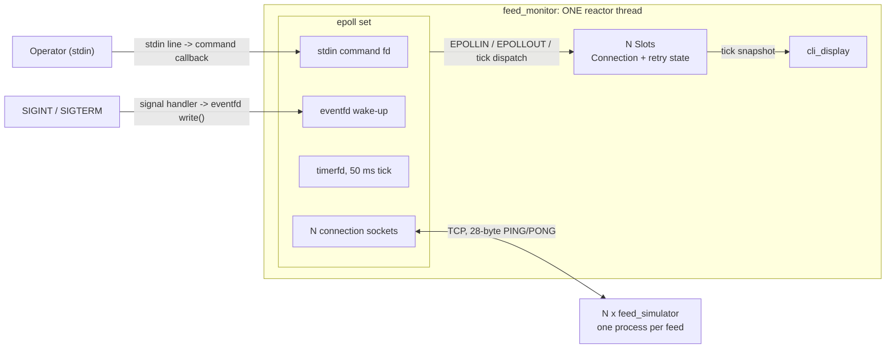
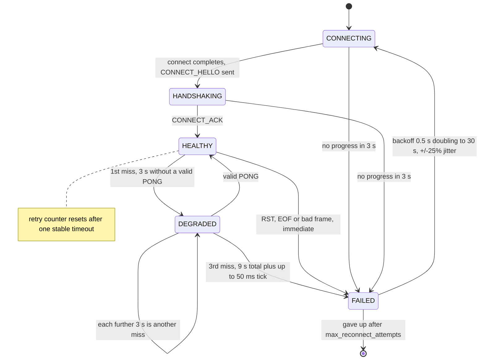
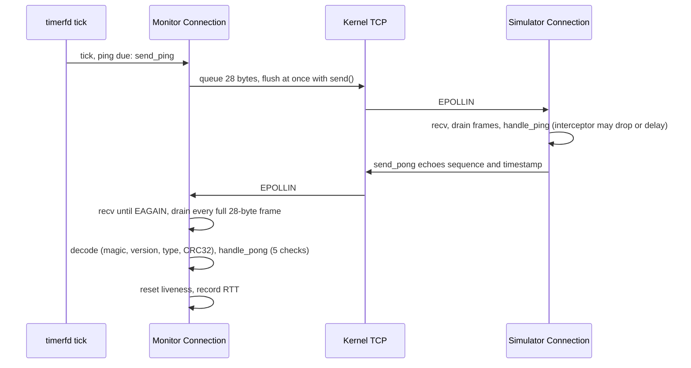

# Vigil: Architecture

## Purpose

A market-data feed can be dead while its TCP socket still looks healthy: the process hung, a middlebox dropped the flow, or the peer vanished without a FIN or RST. The kernel reports nothing, so the only reliable signal is an application-level heartbeat. Vigil is a single-threaded `epoll` monitor that keeps one connection per feed, sends a 28-byte `PING` once per second, and decides from `PONG` replies alone whether each feed is `HEALTHY`, `DEGRADED` or `FAILED`; a fault-injecting simulator provides the feeds.
Pitch and results: [README.md](README.md). How the claims were validated: [METHODOLOGY.md](METHODOLOGY.md#evidence).

## System and threading

**One thread owns all state; the only cross-thread entry is `stop()` (an atomic flag plus an `eventfd` write), and signal handlers do nothing except call it.**

**Diagram A: system overview.** What runs where, and which inputs wake the reactor?


The command fd, tick callback and alert callback all run on the reactor thread, so operator commands mutate slots directly with no lock and no hop. Tests and the demo run several reactors on helper threads, but each reactor is still touched only through `stop()` or its command fd. Ownership is RAII: `UniqueFd` (move-only) closes the epoll, timer and wake-up fds and each socket; the borrowed command fd is a plain `int`. `FeedMonitor` is non-movable and non-copyable because every `Connection` holds a `const Config*` into `config_`; moving the monitor would dangle those pointers (`feed_monitor.h:39-44`).

## Failure detection

**Diagram B: connection state machine.** When does a feed change state, and what does each change cost in time?


Defaults (`config.h:18-27`): `heartbeat_interval` 1 s, `heartbeat_timeout` 3 s, `max_missed_heartbeats` 3, backoff 0.5 s to 30 s, unlimited attempts (`-1`), tick 50 ms. A miss is a full timeout with no valid `PONG`; the liveness clock advances by one timeout per miss, so a long stall counts as several (`connection.cpp:325-335`). `max_reconnect_attempts >= 0` makes a slot give up and stay `FAILED` until the operator types `reconnect <id>`.

**Diagram C: silent-feed timeline.** What does the operator see, and when, if a feed goes quiet but its socket stays open?
```text
T          last valid PONG (HEALTHY)
T + 3 s    miss 1 -> DEGRADED   (pings continue; a valid PONG would restore HEALTHY)
T + 6 s    miss 2 -> still DEGRADED
T + 9 s    miss 3 -> FAILED, fd closed, alert raised   (+ up to 50 ms tick)
~T + 9.4 s backoff of 0.5 s +/-25% (0.375 to 0.625 s) elapses -> new socket, CONNECTING
           handshake -> HEALTHY on CONNECT_ACK
+3 s       one more stable timeout -> reconnect attempt counter reset to 0
```

A `PONG` counts as proof of life only if it passes `Connection::handle_pong` (`connection.cpp:230-270`):
- Wrong `feed_id`, or a sequence that was never sent: protocol violation, connection fails.
- Sequence already acknowledged (32-entry membership ring, because the simulator can reorder replies): ignored.
- Timestamp negative or in the future: rejected before any subtraction, so a forged `INT64_MIN` cannot overflow.
- Round trip `>=` `heartbeat_timeout`: not accepted, so one stale straggler cannot mask the misses since.

## Hot path and framing

**Diagram D: one heartbeat.** What exactly happens between a timer tick and an updated RTT?


Wire layout, big-endian, 28 bytes: magic `0xFEED` (2) | version (1) | type (1) | feed_id (4) | sequence (8) | timestamp_ns (8) | CRC32 over the first 24 bytes (4). `static_assert(sizeof == 28)` pins it (`heartbeat.h:35`); decode checks magic, version, type, then CRC (`heartbeat.cpp:75-100`). The `PING` carries the monitor's own clock reading and the feed echoes it, so RTT needs no clock synchronisation.

Partial reads: `on_readable` recvs 4 KB at a time, appends, and drains every full 28-byte frame immediately, so only a remainder under 28 bytes persists between calls (`connection.cpp:62-70, 104-128`). EOF is recorded and acted on after the data of the same call has been processed, so a final `PONG` or `DISCONNECT` is not lost (`connection.cpp:81-85`).

## Key design decisions

| Decision | Why (and rejected alternative) | Trade-off | Where |
|---|---|---|---|
| 1. Application-layer heartbeat, not socket state | A hung process with an open socket is invisible to the kernel. Rejected: TCP keepalive (default about 2 h 11 min to detect) and `TCP_USER_TIMEOUT` (bounds unacknowledged data, not an idle peer whose kernel still ACKs) | Costs one 28-byte round trip per feed per second | `connection.cpp:300-307, 309-347` |
| 2. Only a fresh, valid `PONG` is proof of life | Any other bytes, stale or replayed replies must not mask a dead feed | Strict rules mean a very slow link reads as failing | `connection.cpp:230-270` |
| 3. Single reactor thread; every input is an fd in one `epoll` set | No locks, one place to reason about ordering. Rejected: thread per connection or pool; measured equal CPU and roughly a quarter less memory at 5,000 feeds ([METHODOLOGY.md](METHODOLOGY.md#benchmark-methodology)) | One-core ceiling, shared fate (see Limits) | `feed_monitor.cpp:36-48, 165-204, 475-487` |
| 4. Fixed 28-byte checksummed frames; desync fails the connection, no resync | Framing is "accumulate 28, decode". Rejected: length prefixes (a corrupt length desyncs everything) and scanning for the magic (can match payload bytes) | Reconnect after any corruption; no version negotiation | `heartbeat.h:34-36`, `connection.cpp:104-128` |
| 5. Every network-fed buffer capped at 64 KB, fails closed | Dropping bytes mid-stream would desync a byte protocol; reconnecting is safer than growing | A slow-draining peer is disconnected | `connection.h:90-91`, `connection.cpp:74-78, 381-386`, `feed_monitor.cpp:418-436` |
| 6. Edge-triggered `epoll`: drain to `EAGAIN`, EOF after data, `EPOLLOUT` only when bytes are queued, deregister before close | One notification per readiness edge. In level-triggered mode a HUP fd left registered would spin for the whole backoff | Every read and accept loop must drain or the fd stalls | `connection.cpp:54-56, 65-95`, `epoll_utils.h:50-56`, `feed_monitor.cpp:238-250, 323-335` |
| 7. Capped exponential backoff, +/-25% jitter, reset only after stability | Feeds failing together must not retry in lockstep; a peer that handshakes then drops must not reset to the base delay forever | Up to 30 s before retry; operator override needed after give-up | `feed_monitor.cpp:263-295, 346-359` |
| 8. Flat `vector` of slots, swap-and-pop removal, two index maps (fd, feed id) | Contiguous iteration on every tick, O(1) lookup from an event | Removal must repoint both maps (a bug here was found and fixed) | `feed_monitor.h:87-89`, `feed_monitor.cpp:118-138` |
| 9. One role-agnostic `Connection` for monitor and simulator, plus a ping-interceptor seam | The simulator exercises the shipping framing and state code; faults (drop, delay) hook in without a second implementation | Role checks inside handlers | `connection.h:43-44, 83-86`, `connection.cpp:185-199`, `feed_simulator.cpp:234` |
| 10. `CLOCK_BOOTTIME`, now passed in (one read per wakeup) | Counts across suspend, so a sleeping host reads as missed heartbeats. RTT uses only the monitor's clock. `timerfd` uses `CLOCK_MONOTONIC` for tick cadence only | Later events in a batch see a slightly stale `now`; a suspend counts as missed heartbeats, by design | `time_utils.h:13-17`, `feed_monitor.cpp:25, 179, 342`, `connection.cpp:254` |

Also: the simulator reserves a spare fd (`/dev/null`) so an `EMFILE` on `accept` sheds the pending connection instead of stalling the listener (`feed_simulator.cpp:195-205`), and one feed failing never touches another's slot, so faults stay isolated per feed.

## Invariants and failure handling

- A `FAILED` slot is not in `index_of_fd_` and its fd is closed (`feed_monitor.cpp:238-250`; `remove_slot_at` does not re-insert it, `:129-135`).
- `EPOLLOUT` is armed iff `wants_write()`; interest is re-synced after each event and each ping (`:323-335, :370`).
- `read_accum_` holds fewer than 28 bytes after a drain (`connection.cpp:104-128`).
- Only the reactor thread mutates slots (`feed_monitor.h:77-78`); events for an fd already removed in the same batch are skipped (`feed_monitor.cpp:197-200`).
- Every failure path (error, EOF, bad frame, timeout, failed send, failed `epoll_ctl`, operator `disconnect`) ends in `on_connection_failed`: deregister, close, alert, schedule reconnect.
- Recovery is backoff, then give-up if configured, then the operator `reconnect <id>` override, which clears the counter and retries on the next tick (`feed_monitor.cpp:152-163`).

## Limits and non-goals

- Shared fate and a one-core ceiling: a slow tick or alert callback (display rendering) delays every feed. The socket `recv` loop has no per-wakeup fairness budget (`connection.cpp:65-95`); only the stdin command reader has one (16 reads, `feed_monitor.cpp:402`).
- The hot path is not allocation-free: `std::vector` and `std::deque` buffers, `std::function` callbacks, and a per-tick stats snapshot when a tick callback is set.
- CRC32 detects corruption, not tampering. The monitor never listens, and the simulator binds `127.0.0.1` by default (`feed_simulator.h:32`).
- IPv4 literals only (`feed_monitor.cpp:65-69`; no DNS on the reactor), Linux only (`epoll`, `timerfd`, `eventfd`, `CLOCK_BOOTTIME`), measured on loopback only.
- Not tested: a monitor-side fd number reused within one `epoll` batch has no dedicated test (the simulator has a churn test).

## Where it is tested

178 tests, run with `make test` (details in [METHODOLOGY.md](METHODOLOGY.md#evidence)).
- State machine, driven with injected timestamps: `N consecutive missed heartbeats transitions HEALTHY -> DEGRADED -> FAILED` (`test/connection_test.cpp`); the `PONG` rules each have a test (stale, future timestamp, never sent, duplicate, wrong `feed_id`).
- Framing: `a message split across two on_readable calls reassembles correctly`, `a final PONG arriving in the same on_readable call as peer EOF is still processed`.
- Monitor: `20 feeds failing simultaneously all reach FAILED, alert individually, and recover on force_reconnect`, `remove_slot_at does not resurrect a stale index_of_fd_ entry` (`test/feed_monitor_test.cpp`).
- End to end: `make demo` runs `demo/lifecycle_demo.cpp` (three real simulators, one monitor; only one feed is faulted and its neighbours must stay `HEALTHY`). `fuzz/drain_read_buffer_fuzz.cpp` fuzzes the accumulate-and-parse path.
