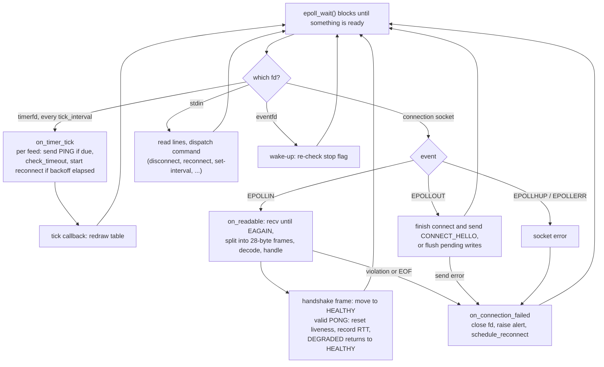
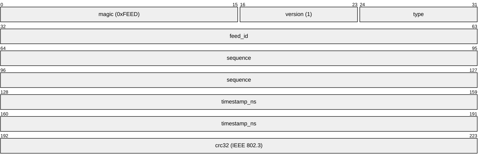

# Vigil: Architecture

Technical reference for the monitor and simulator: components, the threading contract, the event loop, the wire protocol, the connection state machine, and failure handling. The pitch and benchmark results are in [README.md](README.md); how correctness was validated is in [METHODOLOGY.md](METHODOLOGY.md).

> The packet-layout diagram uses Mermaid's `packet-beta` type, which GitHub and recent VS Code previews render; an older renderer shows raw text for that one block.

## Design decisions

- **One reactor thread, not a thread pool.** `FeedMonitor::run()` is a single `epoll_wait()` loop that owns every `Connection`. The price is a strict rule: all reactor state is touched only from that thread. The benefit is no locks, one place to reason about ordering, backoff and failure, and no scheduler jitter between feeds. Measured, it uses the same CPU as thread-per-connection and about 23% less memory (see README).
- **Fixed-size, checksummed messages.** Every message is exactly 28 bytes, so framing is "accumulate 28 bytes, then decode": no length prefixes, no delimiters, no partial-message state machine.
- **Trust is a state machine, not a socket property.** A half-open TCP connection looks healthy to the kernel. Each connection's `ConnectionState` is driven by heartbeat timing and treated as more authoritative than the file descriptor.
- **Bounded everything.** Every buffer fed from the network has a cap and every cap failure has the same outcome: fail the connection cleanly rather than grow without bound or drop bytes mid-stream (which would desync a byte-oriented protocol).

## Components

| Component (`src/`) | Owns | Does not do |
|---|---|---|
| `Connection` (`connection.*`) | One TCP socket, its read and write buffers, its protocol state, its liveness clock. Role-agnostic: the same class is the monitor's initiator and the simulator's responder. | Know about other feeds or decide reconnect policy |
| `FeedMonitor` (`feed_monitor.*`) | The `epoll` reactor, one `Slot` (a `Connection` plus retry bookkeeping) per feed, the timer tick, reconnect scheduling, failure alerts, operator command input | Implement the wire protocol; that is delegated to `Connection` |
| `FeedSimulator` (`feed_simulator.*`) | A real `epoll` server standing in for an exchange feed: accepts clients, answers `PING` with `PONG`, injects faults | Run in production; it exists so the monitor can be tested against real sockets |
| `heartbeat.*` | The 28-byte `HeartbeatMessage`, encode/decode, CRC32 | Anything stateful |
| `Stats` (`stats.*`) | RTT min/max/EWMA (alpha 0.2), a 256-sample ring buffer for percentiles, counters for pings, acks, misses and reconnects | Know what a feed or connection is (dependency-free leaf) |
| `Config` (`config.*`) | Defaults, `key = value` file parser with `[feed]` sections, `getopt_long` CLI; every numeric field range-checked | Abort on bad input: bad lines and flags are reported on stderr and skipped |
| `cli_display.*` | Live table (state, last/EWMA/p99 RTT, misses, reconnects, uptime) and recent alerts; TTY redraw capped near 4 Hz, plain periodic snapshots when not a TTY | |
| `main.cpp`, `main_simulator.cpp` | Argument handling, stdin command parsing, signal handlers, `RLIMIT_NOFILE` raised to the hard limit | |

`FeedMonitor` stores slots in a `std::vector<Slot>` with two index maps (fd to slot, feed id to slot). Removal is swap-and-pop with the maps repointed for the moved slot.

## Threading and event loop

The reactor thread's `epoll` set holds every connection socket plus three auxiliary fds: a `timerfd` (the periodic tick, default 50 ms), an `eventfd` (wake-up for shutdown) and the operator command fd (stdin in the shipped binaries). Nothing else touches reactor state:

- **Signals.** The `SIGINT`/`SIGTERM` handler does an atomic store and a `write()` to the `eventfd`, both async-signal-safe, then the loop sees the stop flag. `SIGPIPE` is ignored and every `send()` uses `MSG_NOSIGNAL`.
- **Operator commands.** The command fd is a non-blocking fd registered in the same `epoll` set; its callback runs on the reactor thread, so command handlers call the mutating methods directly with no cross-thread hop. Tests supply a pipe in place of stdin.
- **Other threads.** Tests, benchmarks and the demo run simulators or monitors on helper threads, but each reactor is still single-threaded; code outside a reactor reaches it only through `stop()` or its command fd. ThreadSanitizer caught two violations of this rule, both in test code.

Edge-triggered mode (the default, `EPOLLET`) requires draining each fd to `EAGAIN` on every wake-up or the connection stalls; `on_readable` and the listener's accept loop both do. A final `PONG` that arrives together with the peer's EOF is still processed before the failure is acted on. Interest in `EPOLLOUT` is armed only while a connection has queued bytes.

Time comes from `CLOCK_BOOTTIME`, which behaves like a monotonic clock but also advances across system suspend, so a feed unreachable during a suspend reads as having missed its heartbeats.

## Wire protocol

Every message is the same 28 bytes, big-endian, no padding (enforced by a `static_assert` in `heartbeat.h`).

| Type | Value | Direction | Meaning |
|---|---:|---|---|
| `CONNECT_HELLO` | 1 | monitor to feed | First message after TCP connect; carries the feed id |
| `CONNECT_ACK` | 2 | feed to monitor | Handshake complete |
| `PING` | 3 | monitor to feed | Periodic heartbeat; carries a sequence and the send time (`CLOCK_BOOTTIME` ns) |
| `PONG` | 4 | feed to monitor | Echoes the `PING`'s sequence and timestamp unchanged |
| `DISCONNECT` | 5 | either | Graceful close notice; the receiver treats it as the peer closing |

The CRC covers the first 24 bytes. The monitor is the only heartbeat initiator, and because it timestamps with its own clock and the feed echoes the value, round-trip time needs no clock synchronization.

How a `PONG` is judged (`Connection::handle_pong`):

| Condition | Outcome |
|---|---|
| Wrong `feed_id`, or a sequence never sent | Protocol violation: connection fails |
| Sequence already acknowledged (32-entry window) | Ignored |
| Timestamp negative or in the future | Remembered as seen, not accepted as liveness |
| Round trip at or above `heartbeat_timeout` | Remembered as seen, not accepted as liveness (a late reply does not prove current health) |
| Otherwise | Liveness clock reset, miss counter cleared, RTT recorded; `DEGRADED` becomes `HEALTHY` |

## Connection state machine

The diagram is in [README.md](README.md#how-it-works). Transitions in code:

| From | To | Trigger |
|---|---|---|
| `CONNECTING` | `HANDSHAKING` | Non-blocking `connect()` completes (`EPOLLOUT`, `SO_ERROR` clean); initiator queues `CONNECT_HELLO` |
| `HANDSHAKING` | `HEALTHY` | Initiator receives a `CONNECT_ACK` with the right feed id (a responder answers `CONNECT_HELLO` with the ack and becomes healthy) |
| `CONNECTING` / `HANDSHAKING` | `FAILED` | No progress for `heartbeat_timeout`, socket error, or protocol violation |
| `HEALTHY` | `DEGRADED` | A full `heartbeat_timeout` since the last valid `PONG` (miss 1) |
| `DEGRADED` | `HEALTHY` | A valid `PONG` |
| `DEGRADED` | `FAILED` | `max_missed_heartbeats` misses; each further `heartbeat_timeout` without a valid `PONG` is another miss |
| any live state | `FAILED` | Socket error, `EPOLLHUP`, peer close or `DISCONNECT`, protocol violation, operator `disconnect <id>` |
| `FAILED` | `CONNECTING` | Backoff timer elapses; a new socket is created and the same `Connection` is rebound |

`DISCONNECTED` also exists in the enum for a slot with no connection yet; a `Connection` itself only occupies `CONNECTING`, `HANDSHAKING`, `HEALTHY`, `DEGRADED` and `FAILED`. A `FAILED` slot waiting out its backoff is shown as `FAILED`; the table's "reconnecting" count is derived from slots that have a backoff timer armed.

## Failure handling

Every failure path ends in the same place: `on_connection_failed` removes the fd from `epoll`, closes it, raises an alert (the display callback, or `[feed_monitor] ALERT: ...` on stderr) and calls `schedule_reconnect`.

| Trigger | Where it is caught |
|---|---|
| Outbound queue over 64 KB (peer not draining) | `queue_write` |
| Inbound accumulator over 64 KB within one `on_readable()` call (flooding peer) | checked inside the recv loop, not only after draining |
| Bad magic, version, type or CRC; desynced stream | `decode_heartbeat` returns false; buffer cleared |
| Message invalid for the current role or state (for example `PING` before the handshake) | `handle_message` handlers |
| Wrong `feed_id` on any message | handlers |
| Peer EOF or `DISCONNECT` | `on_readable` / `handle_message` |
| Operator command line over 64 KB with no newline | Discarded to the next newline; not a connection failure |

**Reconnect backoff.** A failed feed's next attempt is scheduled at `min(base_delay * 2^attempt, max_delay)` (exponent capped at 30), multiplied by a random factor in 0.75 to 1.25 and clamped to `max_delay`. Jitter matters because many feeds failing together (the upstream exchange blipping) would otherwise retry in lockstep and hammer the far end as it recovers. The attempt counter resets once a reconnected feed has stayed `HEALTHY` for one `heartbeat_timeout`. With `max_reconnect_attempts >= 0` the slot gives up after that many tries and stays `FAILED` until the operator types `reconnect <id>`, which clears the counter and retries immediately.

**Runtime retuning.** `set-timeout` resets every connection's liveness baseline (so shrinking the timeout cannot spuriously degrade a healthy feed); `set-interval` pulls pending ping deadlines forward if needed. Both reject values of zero or less.

## Simulator and fault injection

`FeedSimulator` is a `Connection`-per-client `epoll` server (default cap 1,024 clients, `--max-clients`). One instance serves one feed id. It reaps clients that complete no handshake or send no `PING` within its timeout, and sends `DISCONNECT` to every client on shutdown. Accepting survives file-descriptor exhaustion by keeping a spare fd to shed the pending connection, and retries on the next tick.

| Fault | Control | Effect |
|---|---|---|
| Dropped replies | `--drop-rate <0..1>`, stdin `set-drop-rate 
` | A `PING`'s `PONG` is silently not sent; handshake traffic is unaffected |
| Slow replies | `--extra-latency-ms`, `--jitter` | Replies are deferred (jitter scales the delay by 0.5x to 1.5x); queue capped at 4,096, overflow drops |
| Connection reset | stdin `kill` | A random client gets an RST (`SO_LINGER` 0), exercising the socket-error path |

These are application-layer faults. The complementary kernel-level check, `scripts/network_fault_demo.sh`, applies real `tc`/`netem` loss, delay and reordering on loopback to the shipped binaries (root required, so it is not part of `make test` or CI).

## Configuration

Precedence is CLI flags, then the `--config` file, then built-in defaults. Cross-field rules are checked after loading: `heartbeat_interval < heartbeat_timeout`, `reconnect_base_delay <= reconnect_max_delay`, `tick_interval <= heartbeat_interval`; a violating pair reverts to defaults with a warning. The format is documented in [`config/feeds.example.conf`](config/feeds.example.conf), and every flag in [All_commands.md](All_commands.md#cli-reference).
