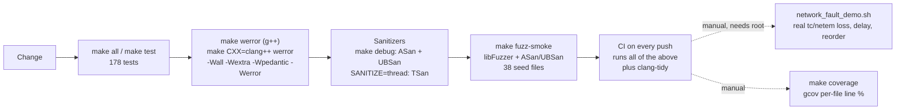
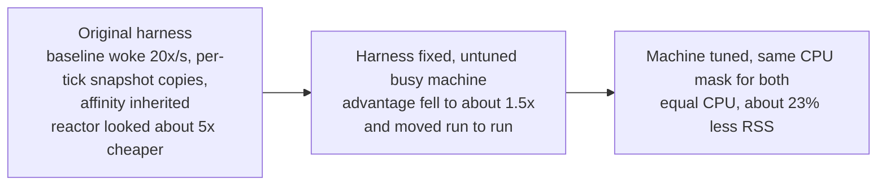

# Vigil: Methodology

How the code's correctness and the benchmark numbers were validated, and what that process found. The system itself is described in [ARCHITECTURE.md](ARCHITECTURE.md); results and the headline claims are in [README.md](README.md).

## Test strategy

178 tests, built on a small header-only harness (`test/mini_test.h`) so the project has no external dependencies. Every test runs under every sanitizer build.

| Suite | Tests | What it covers |
|---|---:|---|
| `heartbeat_test` | 9 | Round trip, big-endian layout, wrong magic/version/type, single-bit corruption, CRC test vector, no padding |
| `stats_test` | 12 | EWMA seeding, ring buffer, percentile interpolation and edge cases |
| `config_test` | 42 | File and CLI parsing, range checks, cross-field rules, precedence, malformed input never aborting |
| `connection_test` | 32 | State transitions at exact injected-time boundaries, handshake, PONG validation (stale, future, duplicate, reordered), buffer caps, partial reads and writes |
| `feed_monitor_test` | 34 | Real reactor against real simulators: fault-injection scenarios, reconnect and backoff, operator commands, many feeds at once, shutdown |
| `feed_simulator_test` | 27 | Handshake and tracking, reaping stuck or silent clients, fault injection, a 300-client burst, client cap, `EMFILE` on accept, fd-number reuse |
| `cli_display_test` | 15 | Table formatting, dashes for missing data, control-character sanitizing, TTY vs plain rendering, alerts |
| `e2e_binary_test` | 8 | `fork`+`exec` of the real `feed_monitor` and `feed_simulator`: live stdin commands, kill and recover, `--help`, exit codes, the shipped sample config |

The fault-injection scenarios in `feed_monitor_test` are the ones that prove the project's purpose rather than its speed: dropped replies drive `HEALTHY` to `DEGRADED` to `FAILED` with a real alert and automatic recovery; a brief drop stays `DEGRADED` and recovers without a reconnect; replies delayed past the timeout still count as unhealthy; backoff doubles within the +/-25% jitter band and is actually randomized; 20 feeds failing at once recover independently; a healthy feed never leaves `HEALTHY`. `make demo` shows the same cycle live, with two neighbouring feeds asserted untouched.

### Revert-test discipline

A test can pass for the wrong reason, so each bug fix was held to a stricter bar than "test passes": write the fix and its regression test, confirm green, temporarily revert only the fix, confirm the test now fails, restore, confirm green again. This caught process bugs as well as code bugs: the first draft of the `read_accum_` cap test passed even with the fix reverted, because an older corrupt-message check was masking it.

## Verification layers

No single technique finds everything, so several are layered. Each finding was verified independently before being acted on: static-analysis hits were read in context and either fixed or dismissed with a written reason.

| Layer | Example of what it caught |
|---|---|
| Manual audit against claimed behavior | A stale `PONG` accepted as proof of health after real heartbeats had been missed |
| Hand-built malformed input | A future-timestamped `PONG` produced a negative RTT and was accepted |
| `clang-tidy` | `atoi`/`atof` silently returning 0 on bad CLI input, so `--port abc` bound a random port |
| ThreadSanitizer | Two data races, both in test code that called reactor methods from the wrong thread |
| Fresh-eyes review of `bench/` | CPU-affinity inheritance that had been contaminating benchmark numbers |
| Fuzzing | No crashes; it pins the parser invariants described below |

Build variants and what ran on each:

| Build | Tests | Benchmarks | Fuzzing | Coverage |
|---|:-:|:-:|:-:|:-:|
| `g++ -O2` (plain) | yes | yes | n/a | no |
| `g++` ASan + UBSan, `-O0` | yes | no | n/a | no |
| `g++` ThreadSanitizer, `-O1` | yes | no | n/a | no |
| `g++` and `clang++`, `-Werror` + libstdc++ assertions | yes | no | n/a | no |
| `clang++ -fsanitize=fuzzer,address,undefined` | n/a | no | yes | no |
| `g++ --coverage -O0` | yes | no | n/a | yes |

Benchmarks only run on the plain optimized build, because sanitizers distort timing. Fuzzing is clang-only (libFuzzer) and never ran under TSan. A `clang++` + ASan/UBSan test run is possible (see [All_commands.md](All_commands.md#second-compiler-verification)) but is not part of the routine pipeline.

### Fuzzing

| Harness | Target | Invariants asserted |
|---|---|---|
| `decode_heartbeat_fuzz` | `decode_heartbeat` on arbitrary 28-byte buffers | A successful decode re-encodes to the exact input bytes; known-type messages survive encode/decode unchanged; unknown types are rejected |
| `drain_read_buffer_fuzz` | `Connection`'s real recv, accumulate, parse path over a real `AF_UNIX` socketpair, arbitrary-length byte streams, both roles, chunked delivery, optional skipped handshake, EOF | No crash or sanitizer finding; a scripted handshake reaches `HEALTHY` before fuzz bytes arrive, so the fuzzer lands on the steady-state paths |

Two things get inputs past the checksum: seed files with valid CRCs (`fuzz/gen_corpus.py` regenerates them) and a custom mutator that recomputes magic, version, type and CRC after each mutation. A dictionary seeds the magic and message types. CI smoke-runs each harness for 30 seconds on every push.

## Benchmark methodology

A benchmark that measures the wrong thing yields a confident, specific, wrong number, so the harness was audited as hard as the code.

**Protocol.** Latency: 500 warmup plus 20,000 measured PING to PONG round trips, 5 repetitions per `tcp_nodelay` setting with alternating trial order, one connection in a closed loop against a real `FeedSimulator`. Throughput: one heartbeat per feed per second (the shipped default cadence, printed in the output), a settle period, then a 10-heartbeat steady-state window, 5 repetitions, reporting min/median/max. CPU is per-thread CPU time of the monitor thread (or the N worker threads for the baseline), excluding the echo peer. The naive baseline runs one connection count per process so RSS is not inflated by an earlier trial's heap high-water mark.

Harness bugs found and fixed:

| Flaw | Effect | Fix |
|---|---|---|
| Fixed trial order (`true` always before `false`) | Confounded the `tcp_nodelay` comparison with CPU-frequency warmup | Alternate trial order |
| CPU% from process-wide `getrusage` | Charged the echo-peer thread's work to the monitor | Per-thread clock via `pthread_getcpuclockid` |
| Trial cadence 5x faster than the shipped defaults | Every CPU% about 5x too high | Default to the real cadence |
| One run per configuration | No variance reported | min/median/max over repetitions |
| Every spawned thread inherited `main()`'s single-CPU pin (and `SCHED_FIFO`) | Thread-per-connection baseline crammed onto one core | Explicit affinity and scheduler reset at every spawn site |
| Baseline thread woke 20 times a second (50 ms sleep slices) for a 1 s heartbeat | Baseline looked far more expensive than the reactor | One interruptible wait per interval |
| Throughput harness copied a full stats snapshot every tick | Inflated the reactor's CPU and RSS | Cheap atomic callback |
| 2 s window caught one or two synchronized ping bursts | Events/s swung 2x | 10-period window after a settle |
| Tail percentiles computed but not printed or charted | A 42µs p99 outlier was hidden | Print and chart tails, mark the worst repetition |
| Machine state undocumented (hybrid cores, powersave governor, thermal throttling) | Unreproducible, noisy numbers | Record tuning and placement; check throttle counters and `nstat` per run |

The effect on the headline comparison:

### Placement and tuning rationale

On a hybrid CPU where the threads run matters more than any software detail, so placement is part of the method and is recorded in [`bench/results/ENVIRONMENT.txt`](bench/results/ENVIRONMENT.txt).

- **Governor `performance`** removes frequency ramp-up as a variable; the first trial of a pair otherwise runs on a cooler, slower clock.
- **Latency on a P-core (CPU 0)** is the default the benchmark pins itself to; a second run on an isolated E-core (`taskset -c 4`, `isolcpus`/`nohz_full`/`rcu_nocbs`, deep C-states off, `SCHED_FIFO` via `setcap cap_sys_nice`) shows the tail with scheduler and idle-state noise removed. `setcap` is lost on every rebuild, so it runs after the build.
- **Throughput on five non-isolated E-cores (`taskset -c 6-9,11`)**, identical for epoll and naive. Isolated cores get no load balancing, which would pile every thread of the baseline onto one core.
- **Validity checks.** The package thermal-throttle counter must not change during a run (a first P-core run was discarded because it rose); `nstat` must show no `ListenOverflows` or `ListenDrops` and almost no retransmits; `net.core.netdev_max_backlog` is raised for the 5,000-connection runs; AC power and a quiet system.
- **Known uncontrolled factors.** CPU frequency was not measured with `turbostat`; the laptop ran warm; VS Code stayed open but idle. The P-core run's occasional 100 to 200µs outliers have no isolated cause.

## Limits of this validation

- Loopback only: the numbers bound software overhead, not network behavior.
- One machine, one session: absolute values will differ elsewhere; the relative comparisons are what to trust.
- TSan and ASan results cover the test suite's scenarios, not arbitrary production workloads; fuzzing is time-boxed (30 s per harness in CI).
- `network_fault_demo.sh` needs root and is manual, so CI does not exercise it.
