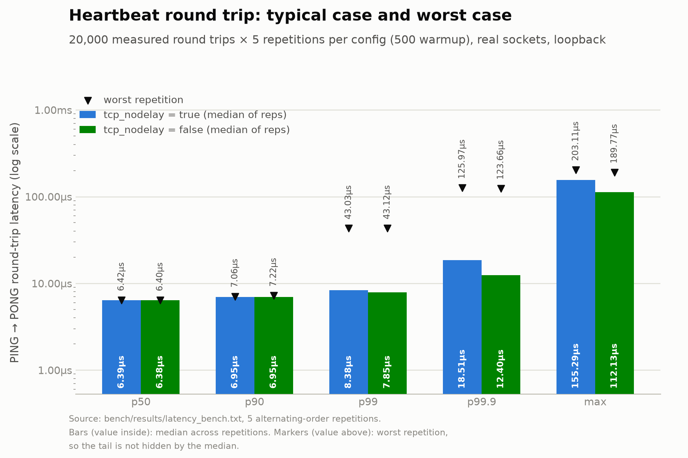
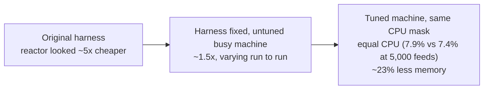
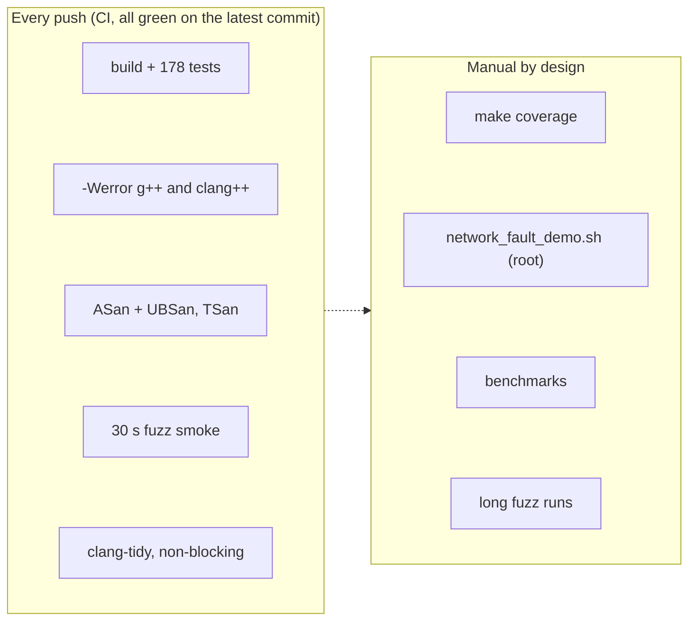

# Vigil: Methodology

How the correctness claims and the benchmark numbers were checked, what each check can and cannot catch, and which of my own measurements turned out to be wrong. Design is in [ARCHITECTURE.md](ARCHITECTURE.md#key-design-decisions); headline results are in [README.md](README.md).

## Scope and threat model

- **Untrusted:** bytes from a peer on the wire. The frame decoder (magic, version, type, CRC32), the stream parser (partial reads, desync, buffer caps) and the PONG validity rules (stale, future, duplicate, unknown sequence) are written and tested as if the peer were hostile.
- **Trusted:** the simulator, commands typed on stdin, and config files. Config parsing is still range-checked and must never abort, but it is not treated as an attack surface.
- **Out of scope:** network realism beyond loopback and one manual `tc netem` script, authentication/TLS, and kernel-bypass networking. Failure semantics are in [ARCHITECTURE.md](ARCHITECTURE.md#failure-detection).

## Evidence

178 tests, three sanitizers, two compilers, two fuzz harnesses (about 81 million recorded executions) and per-file coverage; every row has a command. Test, sanitizer, warning and coverage figures were re-run for this document in a scratch copy of the repo; benchmark figures are read from the committed result files.

| Claim | Evidence | Command to reproduce |
|---|---|---|
| 178 tests pass, including 8 `fork`/`exec` end-to-end tests of the real binaries | `178/178 tests passed` | `make test` |
| ASan + UBSan clean on every test | all 178 pass, `-O0`, libstdc++ assertions on | `make debug` |
| ThreadSanitizer clean on every test | all 178 pass | `make clean && make SANITIZE=thread OPT="-O1 -g" test` |
| Builds warning-free with `-Wall -Wextra -Wpedantic -Werror` on g++ and clang++; CI green | both build and pass 178; the one CI run on the latest pushed commit succeeded, all 8 jobs | `make werror`, `make CXX=clang++ werror`, `gh run list --limit 3` |
| Fuzzing found nothing in a recorded 10-minute ASan + UBSan run | 76,231,442 decoder and 4,590,399 stream-parser executions; cov 18 and 232; 38 seed files, a dictionary, a CRC-fixing mutator ([fuzz/RESULTS.txt](fuzz/RESULTS.txt)) | `make fuzz-smoke FUZZ_TIME=600` |
| Line coverage 84% to 100% on every library file (gcov, lines only, no branch) | `heartbeat` 100, `stats` 100, `cli_display` 98.6, `config` 98.2, `connection` 94.0, `feed_monitor` 87.0, `feed_simulator` 84.0; the entry points `main.cpp` 75.3 and `main_simulator.cpp` 80.2 are reached only through the e2e tests | `make coverage` |
| A feed that goes silent is detected, alerted, and recovered; neighbours are never disturbed | 3-feed scripted run, exits 0 only if NASDAQ recovered and NYSE and LSE stayed `HEALTHY` throughout | `make demo && ./bin/lifecycle_demo` |
| Same behaviour under real kernel packet loss, delay and reordering | 5 phases (baseline, 40% loss, 100% loss, recovery, 300 ms delay + 25% reorder), non-zero exit on a failed assertion. Manual, needs root, not in CI, no recorded output | `sudo ./scripts/network_fault_demo.sh` |
| Latency: p50 6.4 us, p99 8.4 us (P-core); p50 13.1 us, p99.9 17.8 us, max 26.9 us (isolated E-core); medians over 5 repetitions | [latency_bench.txt](bench/results/latency_bench.txt), [latency_bench_isolated.txt](bench/results/latency_bench_isolated.txt) | `./bin/latency_bench 20000 500 5`; isolated: `taskset -c 4 ./bin/latency_bench 20000 500 5` |
| The protocol layer adds about 0.05 us at p50 over a bare-socket echo | same session, two rounds: bare sockets p50 6.08 / 6.12 us vs Vigil 6.16 / 6.14 us ([raw_socket_baseline.txt](bench/results/raw_socket_baseline.txt)) | `./bin/raw_socket_baseline 20000 500 5` |
| 5,000 feeds cost about the same CPU as thread-per-connection and about 23% less memory | CPU 7.91% vs 7.35%; RSS median 50.4 MB (min 34.2, max 51.8) vs 65.8 MB ([epoll](bench/results/throughput_bench_epoll.txt), [naive](bench/results/throughput_bench_naive.txt)) | `taskset -c 6-9,11 ./bin/throughput_bench 10,100,1000,5000 1000 5`; baseline: `... --naive-only N 1000 5` |
| The whole benchmark suite reproduces | one script: placement, throttle and `nstat` checks, charts | `LAT_ISOLATED_CPUS=4 THROUGHPUT_CPUS=6-9,11 REPS=5 bash scripts/run_benchmarks_and_plot.sh` |

## How correctness is verified

- **Three test tiers.** Pure-logic tests (codec, stats, config, display), real-socket integration tests with an injected clock so state transitions are checked at exact nanosecond boundaries, and fork/exec end-to-end tests of the shipped binaries (live stdin commands, kill and recover, exit codes). Suite-by-suite counts are in `test/`.
- **Deterministic fault injection.** The clock is injected, and the simulator has drop-rate, added-latency and kill knobs, so `HEALTHY` to `DEGRADED` to `FAILED` and back is reproduced without sleeping or flakiness. Real kernel loss and delay (`netem`) is exercised only by the manual script.
- **Sanitizers over the full suite.** ASan + UBSan and TSan run every test, not a subset. They see only what the tests exercise.
- **Fuzzing and what the CRC-fixing mutator solves.** A random 28-byte buffer passes CRC32 about once in four billion tries, so deep parser states are unreachable by blind mutation. Seeds with valid CRCs and a mutator that recomputes magic, version, type and CRC after each mutation fix that. Measured in a controlled 60 s run on the current harnesses: the stream parser reached cov 182 / ft 363 with no seeds, dictionary or mutator and cov 232 / ft 851 with all three. The decoder reached cov 18 either way, because it is a 28-byte pure function and the harness also exercises the encode side; there the fuzzer mostly confirms the round-trip invariant.
- **Revert tests.** A passing test can pass for the wrong reason, so the fix is removed and the test must fail. Example, run for this document on the future-timestamp PONG check in `Connection::handle_pong`: replacing its condition with `false` fails `a PONG with a future timestamp is not accepted as a valid heartbeat` (two CHECKs), and restoring it returns 178/178.
- **Coverage, with limits.** Line coverage only, no branch coverage. A covered line shows the code ran, not that the assertions on it are strong or that every error branch was taken.

## Benchmark methodology

**Protocol.** Latency: 500 warmup plus 20,000 measured round trips, 5 repetitions per `tcp_nodelay` setting with alternating order, one connection against a real simulator. Throughput: one heartbeat per feed per second (the shipped cadence), a 1 s settle, then a 10-period steady-state window, 5 repetitions. The same `taskset` mask is used for the epoll reactor and the thread-per-connection baseline. CPU is per-thread CPU time of the monitor (or worker) threads, excluding the echo peer.

**What one latency sample is.** The ping's timestamp is taken immediately before the `send()` that queues and flushes it. The clock is read once right after `epoll_wait` returns, before any parsing, and the sample is that time minus the echoed timestamp. It contains two loopback traversals, the simulator's recv and reply, and the client's wakeup; it excludes the client's own decode and CRC of the reply.

**This is a closed loop.** Each ping is sent the instant the previous pong arrives (back-to-back ping-pong), so it measures service time. If the system stalls, an open-loop sender at a fixed rate would have recorded many delayed samples during the stall (Tene's coordinated omission); this loop records one. So the p99 and p99.9 here understate what a fixed-rate sender would see. The max is kept, not trimmed. The loop is also warm (caches, branch predictors, CPU clocks), whereas production heartbeats are about 1 Hz per feed. These are warm-path floors, not what a cold feed sees.

**Sample counts.** Each p99.9 rests on 20 samples per repetition and each max on one, so a single scheduler hiccup moves them. This is why tails are reported as median and worst repetition across 5 runs.

**Hybrid-CPU placement.** The laptop has P-cores and E-cores. The default run (client pinned to a P-core, simulator floating) and the isolated run (`taskset -c 4`, both threads on one isolated E-core) differ in core type and in thread placement together, so their difference is not attributable to either alone. Isolated cores get no scheduler load balancing, so throughput runs use non-isolated E-cores instead; otherwise every thread of the baseline would pile onto one core.

**Validity checks.** The package thermal-throttle counter must not change during a run (the first P-core run was discarded because it rose, 119 to 239). `nstat` must show no `ListenOverflows` or `ListenDrops` and almost no retransmits. Machine state, governor and tuning are recorded in [bench/results/ENVIRONMENT.txt](bench/results/ENVIRONMENT.txt); the tuning commands are in [All_commands.md](All_commands.md#cpu-tuning-for-benchmarks).

*Median across 5 repetitions (bars) and worst repetition (markers), log scale, P-core run, `tcp_nodelay` true vs false. The two settings overlap everywhere; the 43 us p99 marker and the 124 to 203 us p99.9 and max markers are single repetitions, shown so the tail is not hidden by the median.*

## Bugs in my own benchmark

The first harness produced a confident, specific, wrong answer. Each row below was found by reading the code against what it claimed to measure, and each fix is in the repository.

| What was wrong | Visible effect | Fix |
|---|---|---|
| The thread-per-connection baseline slept in 50 ms slices, waking 20 times a second for a 1 s heartbeat | Baseline looked far costlier than the reactor | One interruptible `poll` per interval (`sleep_or_stop`) |
| The harness's per-tick callback copied a full stats snapshot every tick | Reactor CPU and RSS inflated | Callback reduced to one relaxed atomic store |
| Spawned threads inherited `main()`'s single-CPU pin and `SCHED_FIFO` | Baseline's threads crammed onto one core | `reset_affinity_unpinned()` at every spawn site |
| Fixed trial order (`true` always before `false`) | `tcp_nodelay` comparison confounded with CPU warm-up | Alternate order each repetition |
| A 2 s window caught one or two synchronized ping bursts | Events/s swung about 2x between runs | 10-period window after a settle |
| Tail percentiles were computed but not printed | A 42 us p99 outlier was hidden | `print_spread_report` prints median and worst repetition |
| Machine state (governor, placement, throttling) unrecorded | Results not reproducible | ENVIRONMENT.txt, throttle and `nstat` checks per run |

*Each correction removed an apparent advantage. What survives is memory, not CPU. The outputs of the earlier harness versions were not preserved, so the 5x and 1.5x figures are as recorded at the time, not reproducible.* This follows Gregg's active benchmarking (know what you are really benchmarking, and conclude only about that) and the measurement-bias result of Mytkowicz et al. (ASPLOS 2009): innocuous setup choices can swing results more than the effect under study.

## Negative results

- `tcp_nodelay` true vs false overlap at every percentile on loopback.
- `epoll_max_events` from 16 to 1024 has no effect at 5,000 feeds (CPU 7.6% to 7.9%).
- No CPU advantage over threads. Thread-per-connection was cheaper at N=10 (0.037% vs 0.083%), N=100 (0.18% vs 0.21%) and slightly at N=5,000 (7.35% vs 7.91%); the reactor was cheaper only at N=1,000 (1.35% vs 1.54%). The measurable win is memory.
- The 100 to 200 us P-core outliers have no isolated cause. They also appear in the bare-socket echo (max 153 to 221 us in 7 of its 10 repetitions), so they are not specific to the protocol layer, but I did not trace them further.

## Limitations and next steps

- **Closed-loop, warm-path latency.** Next: an open-loop fixed-rate sender timed from the intended send time, HdrHistogram-style recording, and idle gaps between heartbeats.
- **Loopback, one laptop, one session.** Next: a second machine and a real NIC.
- **Hybrid-core confound.** Next: a same-placement comparison of P and E cores.
- **Effective frequency was not measured** (no `turbostat`) and turbo was left on; the 0.05 us kernel-floor session ran under `powersave` without `SCHED_FIFO`, so it is comparable with itself, not with the tables above.
- **The limiter is not profiled.** Next: `perf stat` and `perf record` on the reactor.
- **Fuzzing is time-boxed, not continuous,** and never ran under TSan. Next: long runs and ClusterFuzzLite or OSS-Fuzz.
- **Coverage is line-only;** the netem script is manual and not in CI.
- **Results come from a working tree** at the time (see ENVIRONMENT.txt), not from one pinned commit.

