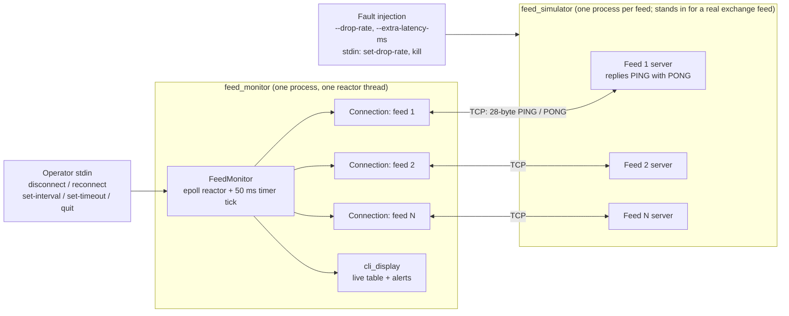
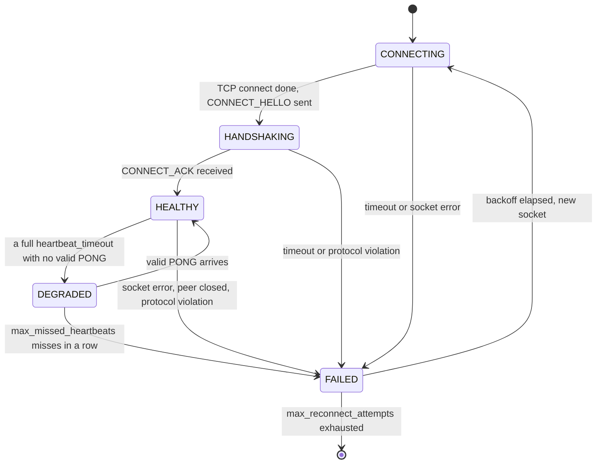
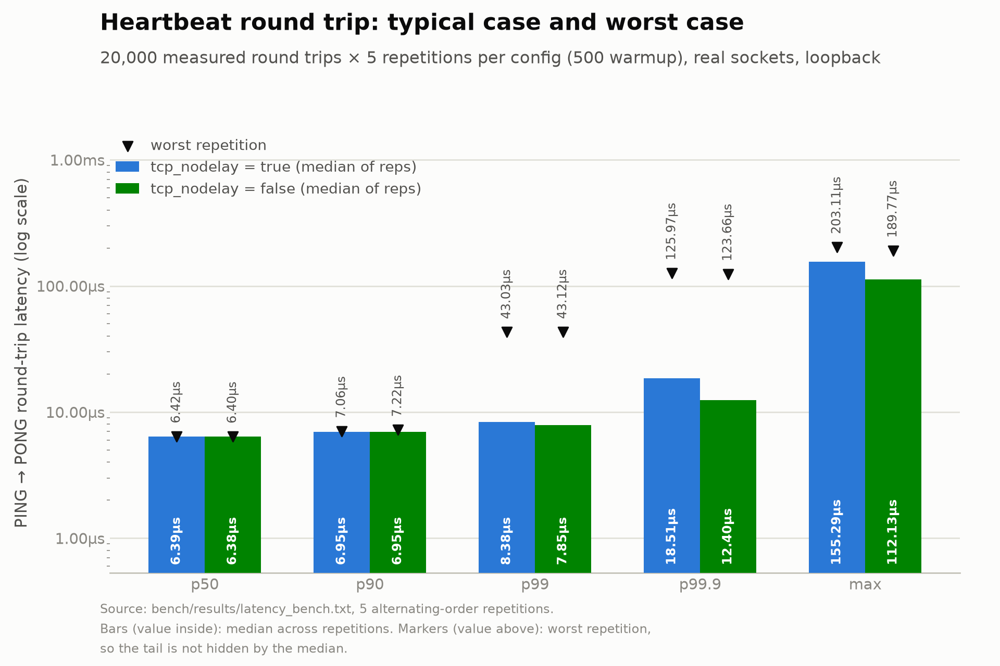
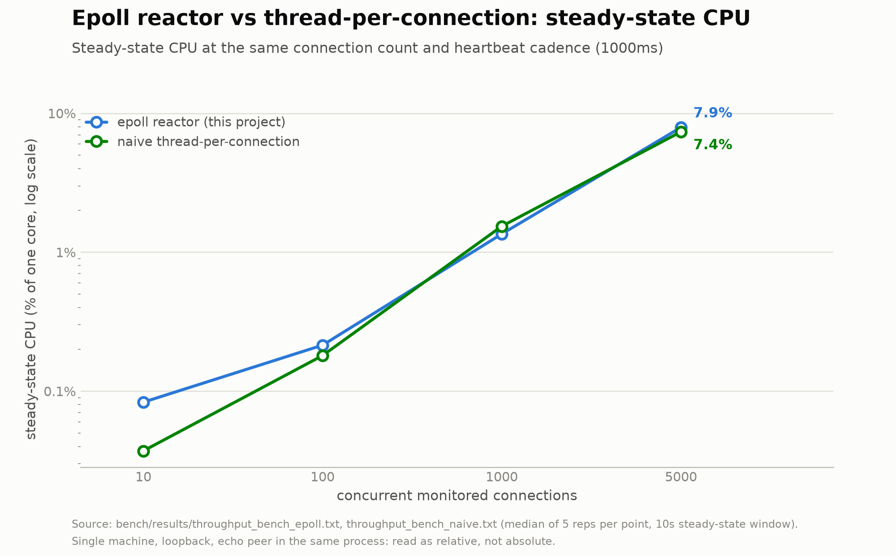

# Vigil: Low-Latency TCP Heartbeat Monitor

[](https://github.com/Shri2909/Vigil-Low-latency-TCP-heartbeat-monitor/actions/workflows/ci.yml)

**A single-threaded `epoll` reactor in C++20 that detects silent market-data feed failures: 6.4µs median heartbeat round trip, 5,000 monitored feeds on about 8% of one core, and automatic detect, degrade, fail, reconnect with no operator action.**

## The problem

A feed connection can die without ever sending a `FIN`: a dead upstream process, a dropped NAT mapping, a partitioned network. The socket still looks healthy to the kernel while no data has moved for minutes, and downstream order books and pricing engines keep trusting stale state. TCP alone will not tell you.

Vigil enforces a heartbeat above TCP: **if a feed has not answered inside `heartbeat_timeout`, stop trusting it, whatever the socket says.** It also handles the operational half: automatic reconnect with exponential backoff and jitter (so correlated failures do not cause a reconnect storm), and fault isolation between feeds.

## Headline results

Measured on one tuned laptop over loopback (details and caveats in [Performance](#performance)).

| Claim | Result |
|---|---|
| Heartbeat round trip (P-core) | p50 **6.4µs**, p99 about 8µs, worst single round trip about 200µs |
| Heartbeat round trip (isolated E-core) | p50 **13.1µs**, p99 about 15µs, worst 32µs in 200,000 round trips |
| 5,000 feeds, 1 s heartbeat | **7.9%** of one core (monitor thread), 50 MB RSS |
| vs. thread-per-connection baseline | **Same CPU** (7.4% for threads), **about 23% less memory** (66 MB for threads) |
| Verification | 178 tests, ASan/UBSan/TSan clean, `-Werror` on g++ and clang++, two libFuzzer harnesses, CI on every push |

Honest framing: the reactor does **not** use less CPU than a well-written thread-per-connection baseline for this idle-heavy workload. Earlier 5x and 1.5x CPU advantages were benchmark artifacts, found and removed (see [METHODOLOGY.md](METHODOLOGY.md)). The case for the reactor is memory, one place to reason about ordering and failure handling, and no scheduler jitter between feeds. Latency figures bound the software's own overhead on loopback; they are not network latencies.

## Architecture

One process, one `epoll` reactor thread, one `Connection` per monitored feed. Timers (`timerfd`), operator stdin, signals (`eventfd`) and every socket share the same `epoll` set, so every state change happens on the reactor thread and nothing needs a lock.



Source layout and the threading contract are in [ARCHITECTURE.md](ARCHITECTURE.md).

## How it works

Every connection's trust level is a state machine driven by heartbeat timing, not by what the kernel reports about the socket.



- **Detection.** The monitor sends a `PING` per feed every `heartbeat_interval` (default 1 s). Each full `heartbeat_timeout` (default 3 s) without a valid `PONG` counts as one miss: the first makes the feed `DEGRADED`, the third (`max_missed_heartbeats`) makes it `FAILED`, so a silent feed is declared dead after about 9 s with the defaults.
- **Strict validation.** Frames are a fixed 28 bytes, big-endian, CRC32-checked. A `PONG` that is stale (round trip at or above the timeout) or future-timestamped is not accepted as proof of health, and duplicates are ignored; a bad CRC, a message in the wrong state, a wrong `feed_id` or a `PONG` for a sequence never sent fails the connection.
- **Recovery.** A failed feed is retried after `min(base * 2^attempt, max)` with plus or minus 25% jitter (defaults 500 ms base, 30 s cap, unlimited attempts). The attempt counter resets once a reconnected feed stays healthy for one `heartbeat_timeout`.
- **Bounded everything.** Read, write and command-line buffers are capped at 64 KB; overflow fails the connection instead of growing memory or silently dropping bytes.

Details: [ARCHITECTURE.md](ARCHITECTURE.md).

## Quick start

Requirements: Linux only (`epoll`, `timerfd`, `eventfd`, `CLOCK_BOOTTIME`, glibc `<endian.h>`), a C++20 compiler (`g++` or `clang++`) and GNU `make`. Fuzzing needs `clang++`; `clang-tidy` and Python with matplotlib/numpy (`scripts/requirements.txt`) are optional.

```bash
make all                                   # bin/feed_monitor and bin/feed_simulator

# Terminal A: the simulated exchange feed (listens on 127.0.0.1 by default)
./bin/feed_simulator --port 9000 --feed-id 1

# Terminal B: the monitor
./bin/feed_monitor --feed 1:DEMO:127.0.0.1:9000 \
    --heartbeat-interval-ms 1000 --heartbeat-timeout-ms 3000 --max-missed 3

# or load feeds and timing from a file (documented sample: config/feeds.example.conf)
./bin/feed_monitor --config config/feeds.example.conf
```

Type into Terminal A (the simulator) to inject faults and watch Terminal B react:

```
set-drop-rate 1     # drop every PONG: HEALTHY -> DEGRADED -> FAILED
set-drop-rate 0     # stop dropping: the monitor reconnects and recovers
kill                # reset a random client connection: socket-error reconnect path
quit                # clean shutdown
```

Terminal B accepts `disconnect <feed_id>`, `reconnect <feed_id>`, `set-interval <ms>`, `set-timeout <ms>`, and `quit` / `exit`. It redraws a live table (state, last/EWMA/p99 RTT, misses, reconnects, uptime) plus recent alerts; when stdout is not a terminal it prints plain snapshots instead.

Or run the scripted three-feed isolation proof (about 8 seconds): NASDAQ is silenced, goes `DEGRADED`, then `FAILED`, reconnects automatically, while NYSE and LSE are asserted to stay `HEALTHY` throughout.

```bash
make demo && ./bin/lifecycle_demo          # exit 0 = recovered and neighbours untouched
```

Every flag, default and range for both binaries is listed in [All_commands.md](All_commands.md#cli-reference).

## Performance

All numbers are from real sockets over loopback on one machine, regenerated from `bench/results/*.txt` by `scripts/generate_key_graphs.py` (no hardcoded values in the chart script).

### Heartbeat round trip



20,000 measured PING to PONG round trips after 500 warmup, times 5 repetitions per `tcp_nodelay` setting, one connection in a closed loop. This isolates per-heartbeat software and kernel-loopback cost; it is not a load test. The chart marks the worst repetition per percentile so the tail is visible.

| Placement | p50 | p99 | worst single round trip |
|---|---:|---:|---:|
| P-core, client pinned to CPU 0 (`latency_bench.txt`, charted) | 6.4µs | 7.9 to 8.4µs median, up to 43µs in a bad repetition | about 200µs |
| Isolated E-core CPU 4, both threads on it, C-states off (`latency_bench_isolated.txt`) | 13.1µs | 14.9 to 15.1µs | 32µs |

The E-core is slower at the median (slower core, two context switches per round trip on one CPU) but has an unusually tight tail; the P-core is about twice as fast with occasional 100 to 200µs outliers (cause not isolated; plausibly other activity on a non-isolated core). Even 200µs is four orders of magnitude below the default 3 s timeout. `tcp_nodelay` true and false overlap within noise, as expected for a strict send-then-wait pattern.

### Epoll reactor vs. thread-per-connection



Same job both ways: one heartbeat per feed per second. Medians over 5 repetitions, each a 10 s steady-state window after a settle period; both variants pinned to the same five cores. CPU is the monitor (or worker) thread time, not the echo peer.

| Connections | Epoll CPU | Threads CPU | Epoll RSS | Threads RSS |
|---:|---:|---:|---:|---:|
| 10 | 0.083% | 0.037% | 4.6 MB | 4.6 MB |
| 100 | 0.21% | 0.18% | 5.4 MB | 5.6 MB |
| 1,000 | 1.35% | 1.54% | 12 MB | 17 MB |
| 5,000 | 7.9% | 7.4% | 50 MB (min 34) | 66 MB |

CPU is essentially the same: threads win slightly at 10 and 100, the reactor at 1,000, threads again at 5,000. The measurable win is memory (about 23% less RSS at 5,000, no per-connection stack). Bringing 5,000 connections to `HEALTHY` takes about 0.19 s for the reactor (about 0.13 s for threads). Batch size (`epoll_max_events` 16 to 1024) makes no measurable difference: 7.6 to 7.9% at 5,000.

Earlier versions of this benchmark showed the reactor 5x, then 1.5x, cheaper. Both were harness artifacts (a baseline that woke each thread 20 times a second, per-tick snapshot copying, CPU-affinity inheritance, then noise on an untuned busy machine). Fixing the harness and tuning the machine removed them; the story is in [METHODOLOGY.md](METHODOLOGY.md).

### Benchmark environment

Machine, kernel parameters and tuning are recorded in [`bench/results/ENVIRONMENT.txt`](bench/results/ENVIRONMENT.txt): 12th-gen Intel i5-1235U laptop (CPUs 0-3 are two SMT P-cores, 4-11 are eight E-cores), AC power, `isolcpus=4,5 nohz_full=4,5 rcu_nocbs=4,5`, `performance` governor, background services stopped. Placement matters more than any software detail on a hybrid CPU:

- **Latency:** the benchmark pins its client to CPU 0 (a P-core) by itself; the second run used `taskset -c 4` on an isolated E-core with deep C-states disabled on CPUs 4 and 5 and `cap_sys_nice` so `SCHED_FIFO` succeeds.
- **Throughput:** `taskset -c 6-9,11` (five non-isolated E-cores) for **both** epoll and naive, so the comparison is like for like. Isolated cores are deliberately avoided here: they get no load balancing, so thousands of threads would pile onto one core.
- **Validity checks:** thermal-throttle counter unchanged during each run (a first P-core attempt was discarded because it rose), no `ListenOverflows` or `ListenDrops`, at most a handful of TCP retransmits.
- **Not controlled:** CPU frequency was not pinned or measured with `turbostat`, and the laptop ran warm. Treat absolute values as "this machine, this session"; the relative comparisons are the point.

## Verification

| Check | Result |
|---|---|
| Unit and integration tests (`make test`) | **178 passing**, including 8 end-to-end tests that fork and exec the real binaries |
| AddressSanitizer + UBSan (`make debug`) | clean |
| ThreadSanitizer | clean; two real races were found during development, both in test code |
| `-Werror` with libstdc++ assertions (`make werror`, `make CXX=clang++ werror`) | clean on g++ and clang++ |
| Fuzzing (libFuzzer + ASan/UBSan, `make fuzz-smoke`) | two harnesses (frame decoder; full `Connection` stream parser), 38 valid-CRC seed files plus a dictionary and a CRC-fixing mutator; no crashes found |
| Static analysis (`clang-tidy`, `.clang-tidy`) | `bugprone-*`, `performance-*`, `clang-analyzer-*`; findings triaged by hand; non-blocking in CI |
| Line coverage (`make coverage`, gcov) | Library files about 85 to 100% (connection.cpp 93%, config.cpp 98%, stats.cpp 100%); the two `main()` files 75 to 80% |
| CI ([ci.yml](.github/workflows/ci.yml)) | on every push and PR: build and tests, `-Werror` on both compilers, ASan/UBSan, TSan, clang++ build, 30 s fuzz smoke per harness, clang-tidy |
| Kernel-level fault injection (`sudo ./scripts/network_fault_demo.sh`) | real `tc`/`netem` loss, delay and reorder against the shipped binaries; manual because it needs root |

How these were validated, and what each layer found: [METHODOLOGY.md](METHODOLOGY.md).

## Reproducing the benchmarks

One command: best-effort tuning, clean rebuild, every benchmark, charts regenerated from the saved files. Results replace the committed ones only after every step succeeds.

```bash
# generic placement (works anywhere; noisier on a busy or hybrid-core machine)
bash scripts/run_benchmarks_and_plot.sh

# the placement behind the committed results (adjust core numbers; `lscpu -e` shows P/E cores)
LAT_ISOLATED_CPUS=4 THROUGHPUT_CPUS=6-9,11 REPS=5 bash scripts/run_benchmarks_and_plot.sh
```

Environment knobs: `LAT_CPUS`, `LAT_ISOLATED_CPUS`, `THROUGHPUT_CPUS` (taskset masks), `REPS` (throughput repetitions, default 3), `COUNTS` (default `10,100,1000,5000`), `LAT_MEASURED`, `LAT_WARMUP`, `LAT_REPS`, `SUITE_GAP_SEC`. The script changes the governor and applies `setcap` only if passwordless `sudo` is available, and warns if the thermal-throttle counter rose during a run.

The manual steps behind the committed results (tuning needs root and is reverted by a reboot):

```bash
# tuning
for g in /sys/devices/system/cpu/cpu*/cpufreq/scaling_governor; do echo performance | sudo tee "$g" >/dev/null; done
# optional, isolated-core latency run only: no deep C-states on the isolated CPUs
for c in 4 5; do for s in 1 2 3 4; do echo 1 | sudo tee /sys/devices/system/cpu/cpu$c/cpuidle/state$s/disable >/dev/null; done; done
sudo sysctl -w net.core.netdev_max_backlog=16384
# plug in AC power, close other apps; this counter must not rise during a run:
#   cat /sys/devices/system/cpu/cpu0/thermal_throttle/package_throttle_count

# build; setcap is lost on every rebuild, so run it after
make clean && make all && make bench
sudo setcap cap_sys_nice+ep bin/latency_bench

# run
mkdir -p bench/results
./bin/latency_bench 20000 500 5 | tee bench/results/latency_bench.txt
taskset -c 4 ./bin/latency_bench 20000 500 5 | tee bench/results/latency_bench_isolated.txt

nstat -n >/dev/null
taskset -c 6-9,11 ./bin/throughput_bench 10,100,1000,5000 1000 5 | tee bench/results/throughput_bench_epoll.txt
nstat | grep -E 'ListenOverflows|ListenDrops|ReqQFull|TimeWaitOverflow|RetransSegs'   # expect ~0
sleep 60
for n in 10 100 1000 5000; do
    taskset -c 6-9,11 ./bin/throughput_bench --naive-only "$n" 1000 5
done | tee bench/results/throughput_bench_naive.txt

python3 scripts/generate_key_graphs.py
```

## Known limitations and design decisions

- **Linux only.** Built directly on `epoll`, `timerfd`, `eventfd` and `CLOCK_BOOTTIME`; no portability layer.
- **IPv4 numeric addresses only.** No DNS and no IPv6: resolving names would need a non-blocking resolver or a worker thread, and the reactor must never block.
- **CRC32 detects corruption, not tampering.** No TLS, shared secret or peer identity. The wire `version` byte is the extension point.
- **The simulator is a test tool.** It has no authentication and binds `127.0.0.1` by default; `--bind` to other interfaces is the operator's call.
- **Single reactor thread.** Simple and lock-free, and what the benchmarks measure, but one slow callback (say, a blocked terminal during the table redraw) delays heartbeat processing for every feed, and one core is the ceiling.
- **Logging is unconditional** and goes to `stderr`; there is no log-level control.
- **Loopback-measured.** The numbers bound the software's own overhead, not real network behaviour.
- **Out of scope by decision:** persistent history and alert routing (logging is `stderr`-only; use `logrotate` or a supervisor), kernel bypass (DPDK, io_uring busy-poll; no benefit on loopback), and CI for root-requiring or long-running steps (`network_fault_demo.sh`, benchmarks, full-length fuzzing stay manual).

## Repository layout

```
src/            Connection, FeedMonitor, FeedSimulator, wire protocol, stats, config, CLI display, two main()s
test/           178 tests with a small in-repo harness (mini_test.h), incl. real-binary end-to-end tests
bench/          latency_bench, throughput_bench, shared helpers; results/ (raw output, ENVIRONMENT.txt), charts/
demo/           lifecycle_demo: scripted three-feed isolation proof
fuzz/           libFuzzer harnesses, seed corpus, dictionary, corpus generator
config/         feeds.example.conf: documented sample for --config
scripts/        run_benchmarks_and_plot.sh, generate_key_graphs.py, network_fault_demo.sh
.github/        CI workflow
```

Documentation: [ARCHITECTURE.md](ARCHITECTURE.md) (components, event loop, wire protocol, failure handling), [METHODOLOGY.md](METHODOLOGY.md) (how correctness and measurements were validated), [PROJECT_PLAN.md](PROJECT_PLAN.md) (design-decision record), [All_commands.md](All_commands.md) (every command and flag).
