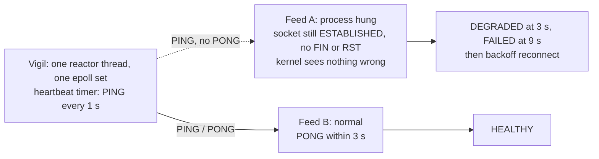
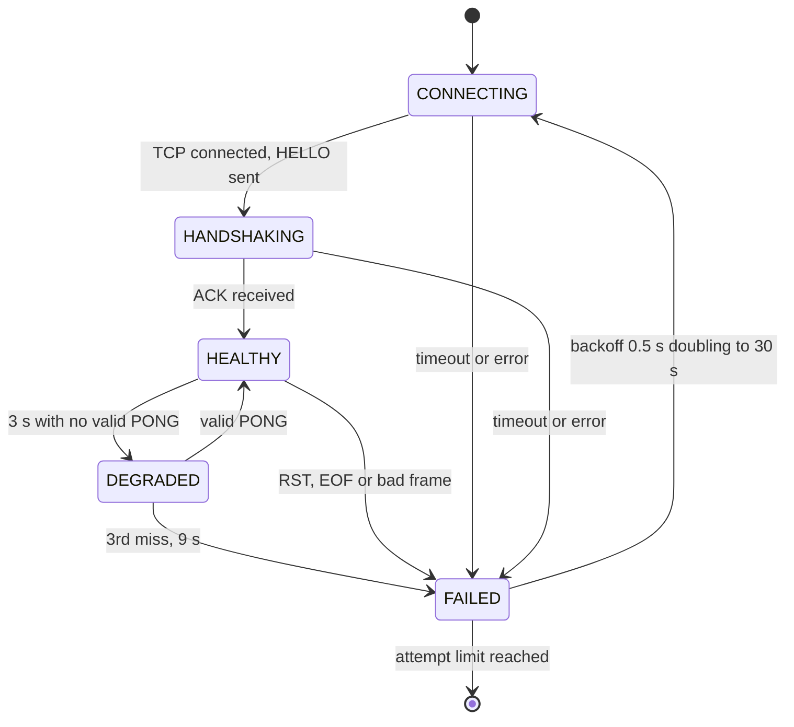

# Vigil: Low-Latency TCP Heartbeat Monitor

[](https://github.com/Shri2909/Vigil-Low-latency-TCP-heartbeat-monitor/actions/workflows/ci.yml)

Detects the feed failures TCP cannot see: a single-threaded `epoll` monitor in C++20 that declares a market-data feed dead when its heartbeat stops, even while the socket still looks healthy, then reconnects it automatically.

- **Silent failure, handled end to end.** With the defaults (3 s timeout x 3 misses) a hung feed goes `DEGRADED`, then `FAILED` in about 9 s, and is reconnected with exponential backoff and jitter. Neighbouring feeds are untouched.
- **Heartbeat round trip p50 6.4µs, p99 about 8µs** on a P-core (loopback, same host, tuned laptop). A bare-socket echo measured in the same way has a p50 of 6.1µs, so Vigil's protocol layer adds about 0.05µs at the median. This bounds software and kernel cost, not network latency.
- **5,000 monitored feeds use about 8% of one core.** A thread-per-connection baseline used the same CPU (7.4%), and the reactor used about 23% less memory (50 vs 66 MB). My first benchmark showed a 5x CPU advantage; that was a bug in the harness, which I found and fixed ([the story](METHODOLOGY.md#bugs-in-my-own-benchmark)).
- **178 tests**, ASan/UBSan/TSan, two libFuzzer harnesses (76M decoder executions, no crashes in a 10-minute recorded run), CI on every push.

## Try it in 10 seconds

```bash
make demo && ./bin/lifecycle_demo
```

Three feeds run against one monitor. NASDAQ goes silent, fails and recovers; NYSE and LSE are asserted to stay `HEALTHY` throughout. About 8 s, exit 0 on success.

## The failure this exists to catch



The kernel keeps reporting `ESTABLISHED` for a dead feed, so downstream consumers keep trusting stale data. Vigil's heartbeat timer, not the socket, decides what is trusted.

## How it works

Each connection is a state machine driven by heartbeat timing, not by what the socket reports.



- **Strict PONG validation.** Only a fresh, valid `PONG` counts as life. Stale or future-dated ones are ignored, and a wrong feed id or a never-sent sequence fails the connection.
- **Bounded buffers.** Read and write buffers are capped at 64 KB and overflow fails the connection closed.
- **Backoff with +-25% jitter**, so correlated failures do not reconnect in lockstep. The attempt limit is opt-in; the default is unlimited.
- **One thread owns all state:** sockets, timers, operator commands and transitions share one `epoll` set, so there are no locks.

## Results


Latency is 20,000 round trips x 5 repetitions on one connection, a back-to-back closed loop, not a 1 Hz heartbeat.

| Setup | p50 | p99 | Worst | What it is not |
|---|---:|---:|---:|---|
| P-core, tuned (performance governor, SCHED_FIFO) | 6.4µs | ~8µs | ~200µs | Not network latency; warm path |
| Isolated E-core, same-core ping-pong | 13.1µs | ~15µs | 32µs | Slower core, two context switches per trip |
| Bare-socket echo, kernel floor (paired run) | 6.1µs | ~7.5µs | ~220µs | No framing, CRC or state machine |
| Vigil, same paired run | 6.15µs | ~7.5µs | ~170µs | Same session: powersave governor, no real-time priority, so compare these two rows with each other |

The paired rows come from [`bench/results/raw_socket_baseline.txt`](bench/results/raw_socket_baseline.txt).

| Feeds (1 heartbeat/s each) | CPU, epoll | CPU, threads | RSS, epoll | RSS, threads |
|---:|---:|---:|---:|---:|
| 100 | 0.21% | 0.18% | 5.4 MB | 5.6 MB |
| 1,000 | 1.35% | 1.54% | 12 MB | 17 MB |
| 5,000 | 7.9% | 7.4% | 50 MB | 66 MB |

Comparable CPU; the reactor wins on memory, not CPU. Both variants were pinned to the same five cores, medians of 5 repetitions. Machine and tuning (i5-1235U laptop, loopback only): [`bench/results/ENVIRONMENT.txt`](bench/results/ENVIRONMENT.txt).

## Run it

Linux, a C++20 compiler and GNU `make`. Two terminals, manual fault injection:

```bash
make all
./bin/feed_simulator --port 9000 --feed-id 1                       # terminal A
./bin/feed_monitor --feed 1:DEMO:127.0.0.1:9000                    # terminal B
```

In A, type `set-drop-rate 1` (stop answering: watch B go `DEGRADED` then `FAILED`), `set-drop-rate 0` (recover), or `kill` (reset the connection). In B, type `disconnect 1`, `reconnect 1`, `set-interval <ms>` or `set-timeout <ms>`.

```bash
make test         # 178 tests, including end-to-end runs of the real binaries
make debug        # ASan + UBSan build and test run
make fuzz-smoke   # libFuzzer, both harnesses (needs clang++)
make bench        # latency, throughput and raw-socket baseline binaries
```

Every flag, benchmark command and tuning step is in [All_commands.md](All_commands.md).

## Engineering evidence

- 178 tests across every component, including 8 end-to-end tests that exec the real binaries.
- Clean under ASan, UBSan and TSan, and under `-Werror` on both g++ and clang++.
- Two libFuzzer harnesses (frame decoder, full stream parser); recorded run in [`fuzz/RESULTS.txt`](fuzz/RESULTS.txt).
- CI on every push: tests, `-Werror`, sanitizers, a 30 s fuzz smoke, non-blocking `clang-tidy`.
- Claim-by-claim evidence with a command to reproduce each: [METHODOLOGY.md](METHODOLOGY.md#evidence).

## Design decisions and limitations

- **Linux and `epoll` only.** No portability layer, by choice.
- **IPv4 literals only, no DNS.** Name resolution blocks, and the reactor must never block.
- **CRC32 detects corruption, not tampering.** No TLS or peer identity; the wire version byte is the extension point.
- **A single reactor thread means shared fate and a one-core ceiling.** One slow callback delays every feed; I chose lock-free simplicity over headroom.
- **Logging is unconditional, to `stderr`.** There are no log levels; this is a known gap, not a tuned choice.
- **Loopback-only measurements.** Real networks were not measured; see [limitations](METHODOLOGY.md#limitations-and-next-steps).

## Read next

- [ARCHITECTURE.md](ARCHITECTURE.md#key-design-decisions): design decisions and diagrams, including [failure detection](ARCHITECTURE.md#failure-detection).
- [METHODOLOGY.md](METHODOLOGY.md): how verification and benchmarks were validated.
- [All_commands.md](All_commands.md): every build, test, fuzz and benchmark command and flag.
